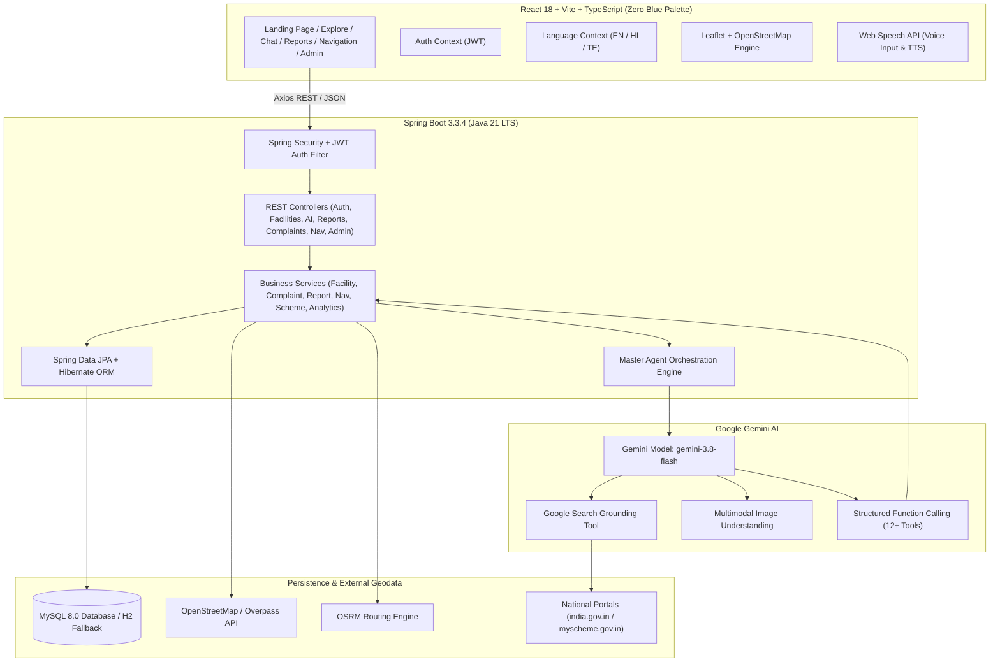
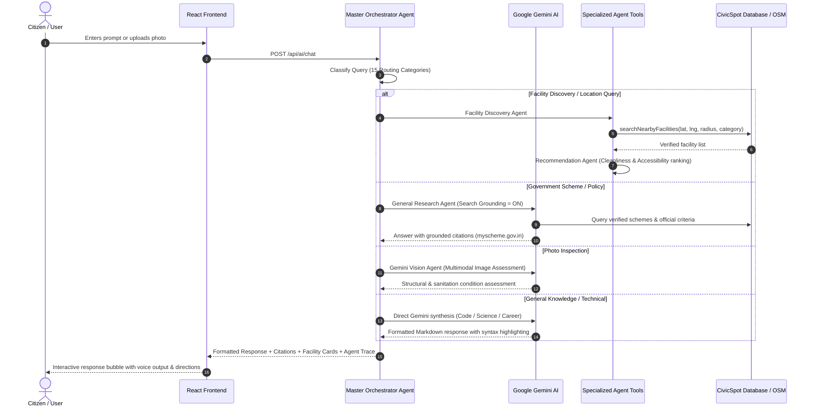
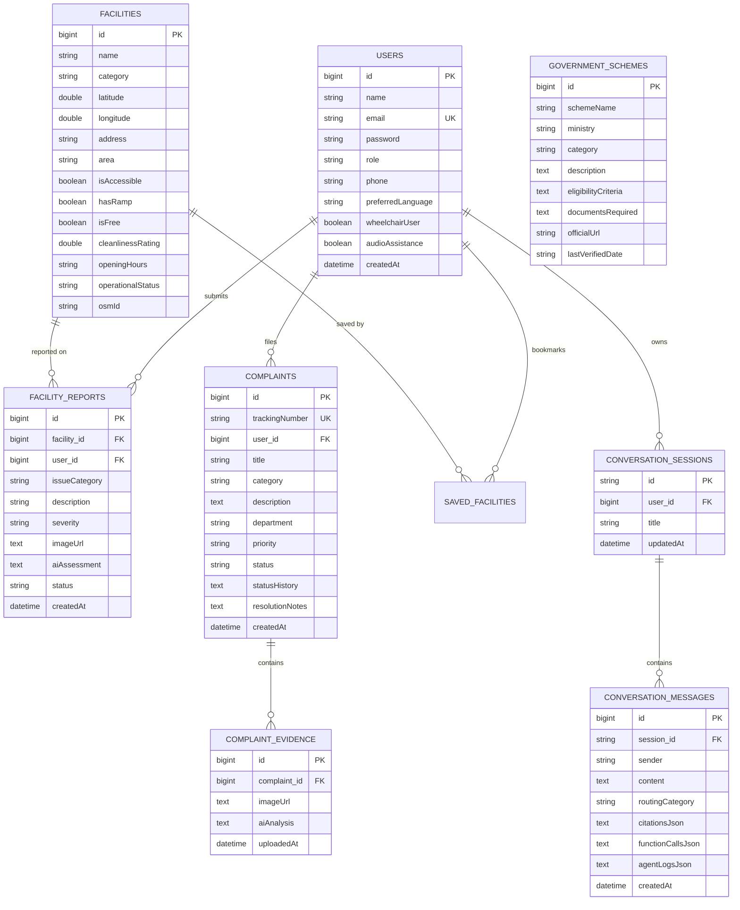

# CIVICSPOT
### Your City. Your Needs. One Intelligent Companion.

CIVICSPOT is a full-stack, general-purpose AI assistant platform enhanced with specialized civic intelligence. It combines broad conversational intelligence powered by **Google Gemini AI** with real-world public infrastructure discovery, smart journey routing, official citizen grievance tracking, and municipal gap analytics.

---

## 1. Product Vision & Philosophy

> *"Give citizens one intelligent place to ask questions, discover services and solve everyday problems."*

CIVICSPOT serves two major roles:

1. **General-Purpose AI Intelligence:**
   Users can converse with **CIVIC AI** on any subject — science, technology, mathematics, education, programming (Java, Python, React, algorithms), career guidance, interview preparation, history, creative writing, and everyday problem-solving. It is **not restricted** to civic topics.

2. **Specialized Civic Assistance:**
   CIVICSPOT coordinates real-world geodata and municipal tools to:
   - Discover public toilets, water ATMs, waste bins, hospitals, pharmacies, police stations, parks, and EV charging stations.
   - Filter by **Wheelchair Accessibility (Sugamya Bharat standards)**, cleanliness ratings, and fee structures.
   - Plan journeys with essential amenity stops along a route corridor.
   - File citizen defect reports with photo uploads and **Gemini Vision AI inspection**.
   - Draft and track official municipal grievances with tracking codes (`CIV-2026-XXXX`).
   - Query verified Government Schemes with official links to `india.gov.in` and `myscheme.gov.in`.
   - Identify urban infrastructure gaps using real analytics telemetry.

---

## 2. Visual Identity — Zero Blue Palette

CIVICSPOT enforces a warm, premium visual identity with **absolutely NO blue shades anywhere**:

| Color Name | Hex Code | Purpose |
| :--- | :--- | :--- |
| **Forest Green** | `#174B38` | Primary brand color, main CTA buttons, active states |
| **Deep Forest** | `#10372B` | Headings, hero headers, dark accents, footer background |
| **Emerald** | `#27845B` | Success indicators, verified badges |
| **Warm Ivory** | `#F8F5EC` | Primary page background, soft card insets |
| **Cream** | `#FFFDF7` | Card background, dropdowns, navigation surfaces |
| **Coral Orange** | `#F07855` | Secondary actions, priority highlights, emergency tags |
| **Soft Peach** | `#FBE5DA` | Warning pill backgrounds, soft alert panels |
| **Golden Yellow** | `#E9B95B` | Star ratings, badges, review metrics |
| **Charcoal** | `#252923` | High-contrast body typography |
| **Muted Grey** | `#777A70` | Secondary descriptions, borders, metadata labels |
| **White** | `#FFFFFF` | Contrast elements, crisp surface highlights |

---

## 3. Architecture & Mermaid Diagrams

### 3.1 High-Level Architecture



### 3.2 Multi-Agent Orchestration Sequence



### 3.3 Database Entity-Relationship Diagram (ERD)



---

## 4. Multi-Agent System & Function Calling

CIVICSPOT features a **Master Orchestrator Agent** coordinating 9 specialized agents:

1. **Master Orchestrator Agent:** Classifies user query across 15 routing categories:
   - `GENERAL_QUESTION`
   - `CURRENT_INFORMATION`
   - `PROGRAMMING_OR_TECHNICAL`
   - `GOVERNMENT_SCHEME`
   - `CIVIC_POLICY`
   - `FACILITY_DISCOVERY`
   - `LOCATION_QUERY`
   - `NAVIGATION`
   - `USER_REPORT`
   - `COMPLAINT_TRACKING`
   - `ACCESSIBILITY`
   - `EMERGENCY_ASSISTANCE`
   - `IMAGE_ANALYSIS`
   - `MULTI_STEP_REQUEST`
   - `OTHER`
2. **General Research Agent:** Knowledge synthesis and Google Search grounding.
3. **Facility Discovery Agent:** Queries Overpass OSM API and database bounding boxes.
4. **Verification Agent:** Cross-checks source authenticity (`india.gov.in`, `myscheme.gov.in`).
5. **Recommendation Agent:** Ranks facilities based on cleanliness scores and user distance.
6. **Navigation Agent:** Coordinates OSRM routing and corridors for amenities along route.
7. **Complaint Agent:** Prepares structured grievance drafts and retrieves tracking status.
8. **Accessibility Agent:** Audits ramps, tactile pathways, and wheelchair-accessible amenities.
9. **Emergency Assistance Agent:** Surfaces verified emergency response helplines (112, 108, 100, 101).
10. **Civic Intelligence Agent:** Multimodal visual assessment using Gemini Vision.

### Function Declarations
The backend provides Gemini access to structured function execution:
- `searchNearbyFacilities(latitude, longitude, radius, category)`
- `searchFacilitiesByPlace(place, category)`
- `getFacilityDetails(facilityId)`
- `getUserComplaints(userId)`
- `getComplaintStatus(trackingNumber)`
- `createComplaintDraft(description, location, category)`
- `submitCitizenReport(report)`
- `planRoute(origin, destination, stops)`
- `findAccessibleFacilities(latitude, longitude)`
- `getCivicAnalytics(area)`
- `saveFacility(userId, facilityId)`

---

## 5. Technology Stack

### Frontend
- **Framework:** React 18 with Vite 8 & TypeScript
- **Styling:** Tailwind CSS (Strict Zero Blue Palette)
- **Routing:** React Router v6
- **Icons:** Lucide React
- **Mapping:** Leaflet & OpenStreetMap
- **Charts:** Recharts
- **HTTP Client:** Axios
- **Markdown & Code:** ReactMarkdown + Remark GFM
- **Voice Capabilities:** Web Speech API (Speech Recognition + Speech Synthesis)

### Backend
- **Language & Runtime:** Java 21 LTS
- **Framework:** Spring Boot 3.3.4
- **Security:** Spring Security 6 + JJWT 0.12.5 (Stateless HMAC-SHA256)
- **Data Persistence:** Spring Data JPA + Hibernate 6
- **Database:** MySQL 8.0 (with built-in H2 profile fallback for instant local dev)
- **HTTP Engine:** Spring WebFlux WebClient (non-blocking external API calls)
- **Validation:** Bean Validation (Jakarta Validation)
- **Build System:** Apache Maven 3.9+

### AI Engine
- **Provider:** Google Gemini API exclusively (`gemini-3.8-flash` configurable)
- **Capabilities:**
  - Google Search Grounding metadata extraction
  - Structured function calling & tool execution
  - Multimodal Vision image inspection
  - Built-in heuristic reasoning fallback for offline testing

---

## 6. How to Run the Application

### 6.1 Prerequisites
- **Java 21 LTS** installed (`java -version`)
- **Maven 3.9+** installed (`mvn -version`)
- **Node.js 20+** and **npm** installed (`node -v`)
- *(Optional)* **Docker** for running MySQL 8.0 in 1 command

---

### 6.2 Database Setup (MySQL 8.0)

You can run MySQL 8.0 in one command using Docker:
```bash
docker compose up -d
```
Alternatively, use an existing local MySQL 8 instance on port `3306` with user `root` and password `root` (or customize credentials in `backend/src/main/resources/application.yml`).

> **Note:** If MySQL is not running on your machine, you can launch the backend with the built-in **H2 profile** (`-Dspring.profiles.active=h2`), which starts an in-memory, persistent, zero-setup database instantly!

---

### 6.3 Backend Setup & Execution

1. Navigate to the backend directory:
   ```bash
   cd backend
   ```

2. Configure environment variables (or create a `.env` / set system env):
   ```bash
   # Set your Gemini API key (optional for basic test, required for live Gemini intelligence)
   export GEMINI_API_KEY="your_actual_gemini_api_key"
   export GEMINI_MODEL="gemini-3.8-flash"
   ```

3. Run the backend test suite:
   ```bash
   mvn test
   ```

4. Start the Spring Boot backend server:
   ```bash
   # Run on MySQL 8:
   mvn spring-boot:run

   # OR run with instant zero-setup in-memory database:
   mvn spring-boot:run -Dspring-boot.run.profiles=h2
   ```

The backend server starts on **`http://localhost:8080`**.

---

### 6.4 Frontend Setup & Execution

1. In a new terminal, navigate to the frontend directory:
   ```bash
   cd frontend
   ```

2. Install dependencies (already installed during initial build):
   ```bash
   npm install
   ```

3. Start the Vite development server:
   ```bash
   npm run dev
   ```

4. Open your browser and navigate to:
   **`http://localhost:5173`**

---

## 7. Demo Accounts & Credentials

The system automatically initializes verified demo credentials upon first startup:

| Account Type | Email | Password | Permissions |
| :--- | :--- | :--- | :--- |
| **Citizen Account** | `citizen@civicspot.org` | `citizen123` | File reports, track complaints, save facilities, full chat |
| **Municipal Administrator** | `admin@civicspot.org` | `admin123` | Full access to Admin Console, status updates, agent logs |

---

## 8. REST API Reference

| Method | Endpoint | Description | Public / Auth |
| :--- | :--- | :--- | :--- |
| `POST` | `/api/auth/register` | Register citizen account | Public |
| `POST` | `/api/auth/login` | Authenticate and obtain JWT | Public |
| `GET` | `/api/auth/me` | Current authenticated user profile | Authenticated |
| `POST` | `/api/ai/chat` | Send prompt to CIVIC AI Master Orchestrator | Public / Auth |
| `POST` | `/api/ai/analyze-image` | Gemini Vision photo inspection | Public |
| `GET` | `/api/facilities` | List / search mapped facilities | Public |
| `GET` | `/api/facilities/nearby` | Haversine proximity facility search | Public |
| `GET` | `/api/facilities/{id}` | Facility details by ID | Public |
| `POST` | `/api/facilities/{id}/save` | Toggle facility bookmark | Authenticated |
| `POST` | `/api/reports` | Submit citizen defect report | Authenticated |
| `GET` | `/api/reports/user` | Current user's reported tickets | Authenticated |
| `POST` | `/api/complaints` | File formal grievance (tracking code) | Authenticated |
| `GET` | `/api/complaints/track/{num}` | Track grievance by `CIV-2026-XXXX` | Public |
| `POST` | `/api/navigation/route` | OSRM route & corridor amenities | Public |
| `GET` | `/api/civic-information/schemes` | Verified Government Schemes directory | Public |
| `GET` | `/api/analytics/overview` | Municipal metrics & infrastructure gaps | Public |
| `GET` | `/api/admin/dashboard` | Admin dashboard overview | Admin only |
| `PATCH` | `/api/reports/{id}/status` | Update report resolution status | Admin only |
| `PATCH` | `/api/complaints/{id}/status` | Update grievance resolution status | Admin only |
| `GET` | `/api/admin/logs` | Real-time agent execution telemetry | Admin only |
| `GET` | `/api/admin/health` | JVM memory, threads, service health | Admin only |

---

## 9. Multilingual & Accessibility Support

- **Multilingual Support:** Instant toggle between English (`EN`), Hindi (`हिंदी`), and Telugu (`తెలుగు`).
- **High-Contrast Mode:** One-click contrast toggle strengthening text borders and typography.
- **Audio Assistance:** Full text-to-speech engine using Web Speech Synthesis reading out AI responses and directions.
- **Voice Input:** Hands-free speech recognition supporting Indian accents.
- **Wheelchair Accessibility Mode:** Filter public amenities equipped with ramps and barrier-free entrances.

---

## 10. Security & Responsible AI

- **Backend-Only AI Communication:** The `GEMINI_API_KEY` is strictly managed on the server and is never exposed in browser bundles or client network requests.
- **Prompt Injection Defense:** User inputs and retrieved external web content are treated as untrusted and encapsulated in strict JSON parts.
- **Role-Based Access Control:** All administrative operations are guarded by Spring Security `@PreAuthorize("hasRole('ADMIN')")` and JWT verification.
- **Grounded Verification:** Citations preserve genuine source URLs from official government websites (`india.gov.in`, `myscheme.gov.in`, `swachhbharaturban.gov.in`).
